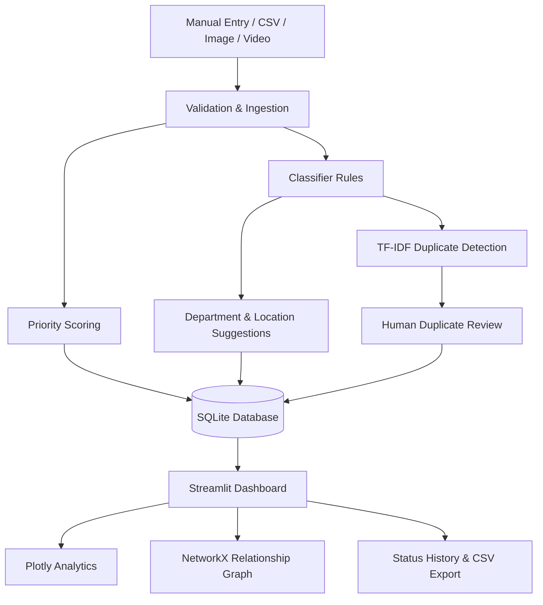

# JanSahayak AI
**Cyber Hackathon 2026 · Problem Statement PS-04**  
AI-Driven Public Grievance Intelligence and Resolution Monitoring Platform

JanSahayak AI is an offline-first, explainable civic-tech prototype for organizing public-service complaints and supporting human triage. It accepts manually supplied posts and CSV files, can extract text from uploaded images, extracts selected video frames for inspection, suggests complaint categories and departments, prioritizes reports with transparent rules, identifies potential duplicates, and tracks case status in SQLite.

> **Data integrity notice:** Demo records are synthetic and clearly labelled. The application does not scrape social platforms, connect to live feeds, or establish that a complaint is true. Use only publicly accessible or lawfully supplied material. Human verification is required before operational action.

## Features implemented

- **Ingestion:** manual entry, CSV import (required `text` column, up to 2,000 rows / 5 MB), per-row validation, supported image/video upload (25 MB cap).
- **Persistence:** SQLite schema is created automatically; complaints and lifecycle history persist across restarts. Database path can be changed using `JANSAHAYAK_DB`.
- **Classification:** deterministic English/basic Hinglish keyword rules for roads/potholes, water supply, electricity, sanitation, public infrastructure, civic safety and other. Shows keyword evidence, explanation, certainty indicator, simple sentiment and review flag.
- **Priority:** transparent configurable points for severity words, recurrence volume, age/duration and a small capped engagement contribution. Shows reasons and disclaimer.
- **Duplicates:** TF-IDF/cosine similarity (with a standard-library fallback), location agreement context, review decisions, and a NetworkX-derived graph. Similarity never merges records automatically.
- **Media lab:** OCR through Pillow + pytesseract if the Tesseract executable is installed; selected video frames through OpenCV; preview and OCR on frames; graceful unavailable/failure status.
- **Location & departments:** accepts supplied location or extracts a narrow set of explicit text patterns with low certainty. Department mapping is configurable in `location_service.py`. No geocoding or coordinate guessing.
- **Dashboard:** database-derived metrics, charts, searchable/filterable register, status history, CSV export, department workload, duplicate review, relationship graph, and map only when valid coordinates exist.
- **Tests:** pytest coverage for classifier, priority, duplicate detection, upload validation, location/department logic, SQLite persistence, status history and duplicate review persistence.

## Architecture



## Folder structure

```text
JanSahayakAI/
├── app.py                    # Streamlit pages and workflows
├── classifier.py             # Explainable category, intent and sentiment rules
├── priority.py               # Priority scoring and reasons
├── duplicate_detector.py     # TF-IDF similarity candidates
├── media_analyzer.py         # Upload validation, OCR, video frames
├── location_service.py       # Conservative location and department suggestions
├── database.py               # SQLite schema and persistence functions
├── analytics.py              # DataFrame and dashboard metrics
├── data/
│   └── sample_complaints.csv # Clearly synthetic demo records
├── tests/
│   └── test_core.py
├── requirements.txt
├── .gitignore
└── README.md
```

## Requirements

- Python **3.12** recommended.
- Windows PowerShell, macOS, or Linux.
- Internet access is only needed to install Python packages. The core demo uses no paid API, model download, or secret key.
- For OCR, install the **Tesseract OCR executable** separately and make sure `tesseract` is on PATH. The Python `pytesseract` package is only a wrapper.
- Video support requires compatible OpenCV wheels. The app reports a graceful status if optional media dependencies cannot load.

## Windows PowerShell setup

Open PowerShell in the project folder:

```powershell
py -3.12 --version
py -3.12 -m venv .venv
.\.venv\Scripts\Activate.ps1
python -m pip install --upgrade pip
pip install -r requirements.txt
```

If PowerShell blocks activation, run this for the current terminal only:

```powershell
Set-ExecutionPolicy -Scope Process -ExecutionPolicy Bypass
.\.venv\Scripts\Activate.ps1
```

Start the app:

```powershell
streamlit run app.py
```

Streamlit prints a local URL, normally `http://localhost:8501`. If the Python launcher cannot find 3.12, install Python 3.12 from python.org, enable the launcher/PATH options, reopen PowerShell and retry. Python 3.14 may not yet have compatible wheels for every dependency; Python 3.12 is the recommended baseline.

## Run tests

```powershell
python -m pytest -q
```

Tests use a temporary SQLite database and do not modify the app's demo database. Test results should be reported only after actually running this command in the target environment.

## Demo walkthrough (3–5 minutes)

1. Launch the app and click **Load synthetic demo data** in the sidebar.
2. On **Overview**, explain the database-derived metrics and category/time charts.
3. Open **Complaints**, filter to water supply or high priority, open a case, and change its lifecycle status. Show status history and export filtered CSV.
4. On **Add / Import**, enter a sample grievance such as “Paani nahi aa raha near Rajendra Nagar, please restore water supply”. Explain keyword evidence and department recommendation.
5. On **Duplicate Review**, inspect similar pothole reports and save a human review decision. Explain why the app does not auto-merge.
6. On **Analytics & Network**, show related-report edges and department workload.
7. On **Media Lab**, upload a sample screenshot or video if available. Explain OCR limitations and verify extracted text manually.
8. Show **About & Help** to communicate scope and honest limitations to judges.

## Team of four: suggested ownership

- **Member 1 — Ingestion & database:** `database.py`, CSV/manual ingestion in `app.py`, schema and validation tests. Commits such as `feat: persist complaint records and status history`.
- **Member 2 — Text intelligence:** `classifier.py`, `location_service.py`, multilingual test cases. Commits such as `feat: add explainable bilingual grievance rules`.
- **Member 3 — Triage & similarity:** `priority.py`, `duplicate_detector.py`, review workflow and tests. Commits such as `feat: add explainable priority and duplicate candidates`.
- **Member 4 — Dashboard & media:** Streamlit visual design, `analytics.py`, `media_analyzer.py`, README/demo. Commits such as `feat: add media lab and analytics dashboard`.

Integrate through small pull requests and keep interfaces stable. Suggested sequence: (1) `chore: scaffold project and dependencies`, (2) `feat: add sqlite schema`, (3) `feat: classify grievances`, (4) `feat: score priority and find duplicates`, (5) `feat: add dashboard workflows`, (6) `test: cover core processing`, (7) `docs: add setup and demo guide`. Commit only working, reviewable increments. Never commit real personal data, credentials, local databases or uploaded media.

## Implemented vs heuristic vs future work

| Area | Current status |
|---|---|
| SQLite persistence, status history, CSV export | Implemented |
| Manual input and CSV import validation | Implemented |
| Image OCR and video frame extraction | Implemented when local dependencies are installed; otherwise reports unavailable |
| Categories, intent, sentiment, location text extraction | Lightweight heuristics; not a trained language model |
| Priority score | Explainable heuristic; not an official risk score |
| Duplicate candidates | TF-IDF/cosine similarity plus location context; requires human review |
| Charts and relationship graph | Implemented from stored records |
| Map | Only for supplied valid coordinates; no automatic geocoding |
| Live social monitoring | Not implemented; no platform APIs or scraping |
| Image damage recognition / video scene understanding | Not implemented |
| Authentication, RBAC, audit-grade security, production hosting | Future work |
| Full Hindi language understanding and robust named-entity recognition | Future work |

## Security and privacy notes

- Treat all uploads as untrusted data; the application does not execute uploaded content.
- Keep files under the stated size limits and avoid collecting names, phone numbers, or other unnecessary identifiers.
- This prototype has no user login or access-control layer. Do not deploy it publicly with sensitive complaints without adding authentication, authorization, audit controls, backups and a security review.
- Coordinates are stored only when supplied in a record; current UI does not infer them from images or place names.
- Engagement is deliberately capped and cannot independently produce a high priority score.
- Rules and keyword lists can be edited in `classifier.py`, `priority.py`, and `location_service.py`. Document any tuning and test it against representative, lawfully obtained examples.

## Troubleshooting

- **`Python was not found`:** install Python 3.12, reopen PowerShell and check `py -3.12 --version`.
- **Package install errors:** use Python 3.12 and upgrade pip inside the virtual environment.
- **OCR unavailable:** install Tesseract separately and confirm `tesseract --version`; then reinstall Python dependencies.
- **Video extraction failed:** try a valid, small MP4; some codecs may not be supported by the local OpenCV build.
- **Reset local data:** stop Streamlit and delete `jansahayak.db` only if you intend to remove all locally stored records. The app recreates its schema on the next run.
